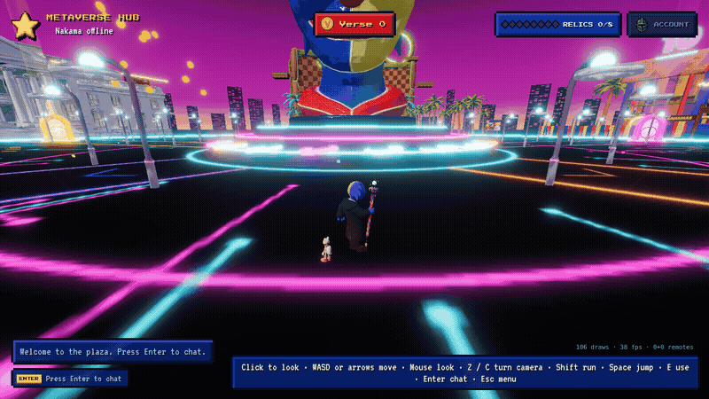

# Follower pets

The GIF uses the development art preview (`/hub/?pet=pet_nobu`). The owner walks
about 18 metres to the right; Nobu follows using the same collision/follow code as
an account-equipped pet. Preview parameters cannot equip or broadcast unowned pets
in production.

## Catalog and ownership

`server/data/follower-pets.json` is shared by the browser and the generated Nakama
catalog (`embed-shop.mjs`). It defines id, display name, model/primitive reference,
height, follow speed, idle clip, reserved Tickets price, and unlock relic:

| Pet | Unlock | Art |
| --- | --- | --- |
| Spark | Free starter for every account | Primitive orb |
| Nobu | Cone's Tip (`cones_tip`) | Existing Nobu model |
| Speed Sproto | HPOS10I Core (`hpos10i_core`) | Existing Speed Sproto model |

Every non-starter choice in the panel requires its relic. Existing item grants,
legacy pet entitlements, store contracts, Tickets and Verse are preserved. This
change does not add economy writes or buy buttons. `pets.catalog` exposes the
reserved price fields and `pet_buying` feature flag; absent rows default off. No
flag rows are enabled or seeded by this change, and no purchase RPC is provided.

On profile/equip reads, Nakama derives ownership from trusted relic/item records
and adds the free starter, then materializes the owned ids in `pets/owned` with
owner-only read and server-only write permissions. The existing `loadout.set_hub`
RPC equips one owned id or null in `loadout/hub`, with optimistic concurrency and
monotonic sequence numbers. All reads/writes use the session's user id. Storage
before-hooks reject direct client writes and deletes of both protected records,
including attempts to create them before the first profile request.

## Following and multiplayer

The shared realm shell installs a pet capsule against that realm's existing BVH,
including the Bar's collision geometry. Bounded swept steps and exponential easing
trail the owner's movement heading at 3 m. Pets render at twice their authored
size, including both animated LODs, the starter orb, and remote impostors. Their
collision capsule, animated clearance bounds, and owner spacing scale with them.
A gap over 10 m or a large vertical
warp resets at the owner's traversable position and resumes following. Reloads
and realm changes hydrate equipment from the account profile and match join.

Only the equipped id is sent in the existing presence roster. Match joins and
rate-limited PROFILE messages read equipment on the server, ignoring client pet
claims. Pose packets and tick frequency are unchanged. Each client simulates pets
from interpolated owner positions. Two nearby remote pets use animated models;
the others share one instanced primitive draw, just as distant avatars use an
impostor. Motion vectors, sweep callbacks and instancing matrices are reused.
Hidden pets skip simulation and rendering; the preference persists in this browser.

## Validation

- RPC unit tests: starter entitlement, Nobu's relic gate, equip/unequip, stale and
  replayed sequences, forbidden foreign-user/ownership fields, session scope,
  storage permissions/hooks, persisted equipment at match join, forged presence.
- Follow unit test: stable easing, reused position, portal snap, long frames and a
  wall using the real BVH collision implementation.
- Live Nakama pet tests: direct storage creation/deletion rejected before profile,
  foreign-user rejection, and starter equip/unequip persistence.
- `npm run lint`, `npm run typecheck`, `npm test`, production build, realtime suite,
  and the Fighter sim-version pin check. Local production build uses a throwaway
  `VITE_NAKAMA_SERVER_KEY` value for bundle validation.

For crowd reproduction use `/hub/?bots=49` and
`/hub/?bots=49&botPets&pet=pet_starter` in development. This adds 49 remote pets plus
the local starter without any server or economy changes. A GPU-capable browser is
needed to assess the production frame-time target; software-rendered cloud Chrome
measurements are comparative only.

The 1280×720 cloud Chrome crowd run rendered 6 near and 43 far avatars:

| Scene | Main scene draws | RAF median | RAF p95 |
| --- | ---: | ---: | ---: |
| 49 remotes, no pets | 124 | 1583 ms | 2767 ms |
| 49 remotes + pets + local starter | 140 | 1467 ms | 2717 ms |

Both stay below the existing 150-draw warning threshold. This environment uses
SwiftShader and cannot validate a production GPU FPS target. The HUD's displayed
FPS is based on clamped simulation delta and is not a reliable timing measure on
this software renderer; the table uses requestAnimationFrame intervals.

### Existing CI blocker

The PR's Shooter simulation check fails because upstream main
`82d5ab51b0eaa487f225f86e77ff93e94133dc89` changes simulation/data/server sources
since the hub's pin `acafce3a39046d8117f29f068b3a57358fa89f77`. The check script,
Shooter/Coop vendor artifacts and pin metadata are unchanged by this PR. Resolving
that upstream drift requires a separate coordinated Shooter refresh; this change
does not bypass the check. Fighter and Coop sim-version workflows pass.
